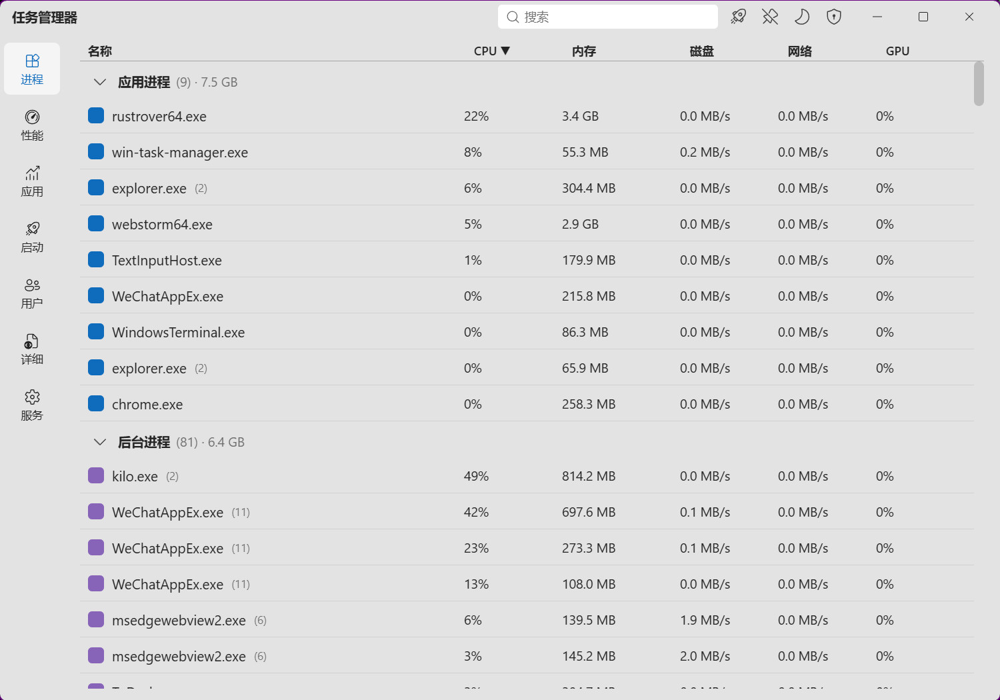

# Windows 任务管理器（Rust 实现）

使用 Rust（[Tauri 2](https://tauri.app)）+ React + Fluent UI v9 实现的 Windows 11 风格任务管理器，操作体验与系统原生任务管理器保持一致：Mica 半透明背景、自定义集成顶栏、左侧导航轨、7 个标签页，以及结束任务 / 运行新任务 / 置顶 / 效率模式 / 设置优先级等服务级操作。



## 功能特性

- **进程**：按「应用 / 后台 / Windows 进程」三组分类，列排序、搜索过滤、分组折叠；右键菜单结束任务、打开文件位置、查看属性、联机搜索、效率模式。
- **性能**：CPU / 内存 / 各磁盘 / 各网络 / 各 GPU 的实时折线图与摘要；CPU 满载归一化为 `核心数 × 100%`，与系统一致。
- **应用历史记录**：按应用累积 CPU 时间与网络用量，持久化存储，可重置。
- **启动应用**：读取 `Run` 注册表键、启动文件夹、`StartupApproved` 禁用状态。
- **用户**：按会话 / 账户分组展示各用户进程。
- **详细信息**：经典列表（PID / 账户 / CPU / 内存 / 状态 / 会话），右键设置进程优先级。
- **服务**：枚举 Win32 服务，查看启动类型（含「自动(延迟启动)」）与描述，启动 / 停止 / 重启，一键打开 `services.msc`。
- **全局**：深 / 浅色随系统切换、窗口置顶、可选管理员身份运行（结束系统进程等）。

## 技术栈

| 层 | 选型 |
|----|------|
| 桌面框架 | Tauri 2 |
| 前端 | React 18 + TypeScript + Vite + Fluent UI v9 |
| 状态管理 | Zustand |
| 系统采集 | `windows` crate 直调 Win32 / PDH / DXGI |
| 背景特效 | `window-vibrancy`（Win11 Mica） |

## 关键实现

- **CPU（进程）周期法**：`QueryProcessCycleTime` + `QueryIdleProcessorCycleTime`，`CPU% = 进程Δ周期 / (空闲Δ周期 + 忙碌Δ周期) × 核心数 × 100`，数值贴近系统任务管理器。
- **CPU / 磁盘 / 网络 / GPU**：PDH 计数器（`\Processor(*)`、`\PhysicalDisk(*)`、`\Network Interface(*)`、`\GPU Engine(*)`），GPU 按 LUID 关联 DXGI 适配器并去重。
- **内存**：`GlobalMemoryStatusEx` + `GetPerformanceInfo`（使用中 / 已提交 / 缓存 / 分页池 / 非分页池）。
- **服务配置缓存**：启动类型 / 描述 / 路径缓存，仅在「服务」标签激活时枚举，避免后台空转。
- **推送式数据流**：后端线程按固定间隔采样，经 Tauri 事件推送到前端 store。

## 项目结构

```
task_manager_gui/
├── src/                 # React 前端
│   ├── components/      # 标题栏、导航轨、图表、右键菜单
│   ├── views/           # 7 个标签页视图
│   ├── store/  lib/  styles/
├── src-tauri/           # Rust 后端
│   └── src/
│       ├── processes.rs   # 进程枚举与度量（周期法）
│       ├── performance.rs # 全局性能（PDH/DXGI）
│       ├── pdh.rs         # PDH 帮助
│       ├── services.rs    # 服务枚举与控制（带缓存）
│       ├── startup.rs  users.rs  apphistory.rs
│       ├── commands.rs     # Tauri 命令
│       └── collector.rs    # 采样调度与事件推送
└── docs/ARCHITECTURE.md  # 架构与技术方案
```

## 运行

需要已安装 Rust、Node.js 与 Tauri 2 系统依赖（Windows SDK / WebView2）。

```bash
# 安装前端依赖
pnpm install   # 或 npm install

# 方式一：开发模式（热重载，需 Vite 开发服务器）
pnpm run tauri dev

# 方式二：自包含预览（前端内嵌，无需开发服务器）
pnpm run build
cargo build --manifest-path src-tauri/Cargo.toml --features tauri/custom-protocol
src-tauri\target\debug\win-task-manager.exe

# 方式三：发布打包（生成 MSI / NSIS 安装包）
pnpm run tauri build
```

## 已知限制

- 进程级网络为近似值（精确值需 ETW）。
- 启动应用「影响程度」显示「未测量」（需启动 ETW 测量）。
- 进程图标暂以类别色块占位（`SHGetFileInfo` 提取可后续补全）。
